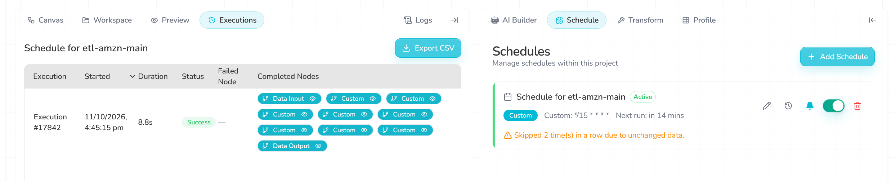
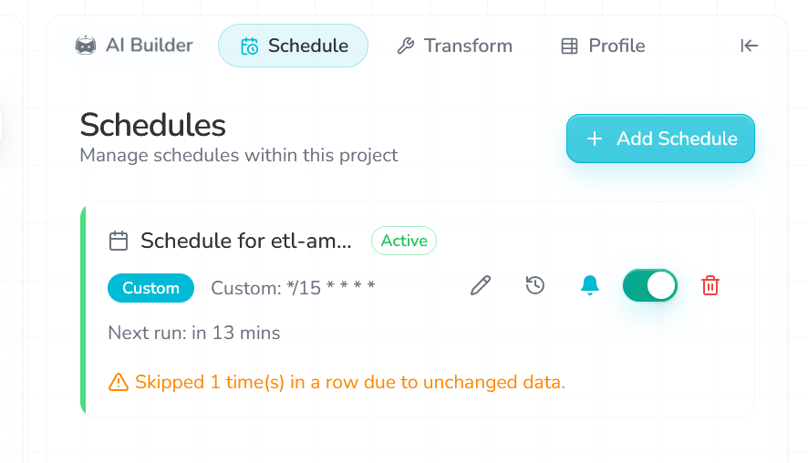
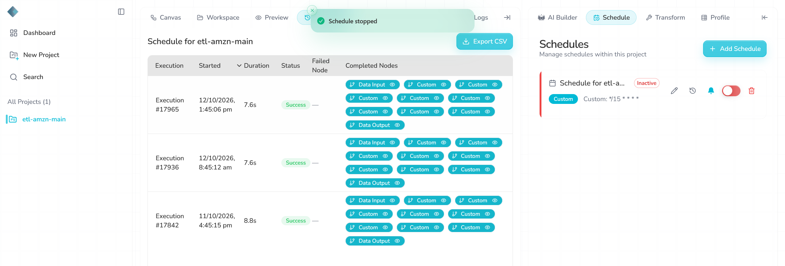

# Schedule behaviour

**Severity:** High. The schedule does not reliably process a new file by itself, skips silently, and repeats failures every 15 minutes.

## Setup
| Item | Value |
|---|---|
| Cron | `*/15 * * * *` (every 15 minutes) |
| Notify on failure | On |
| Where runs are listed | Executions view (clock icon on the schedule card), with Export CSV |

## Summary
1. **A changed S3 file alone never triggered a run.** The schedule skipped with "Skipped due to unchanged data", even right after a new file was uploaded.
2. **Skips leave no record.** Executions and its CSV only list runs that happened.
3. **After a failure, it re-runs the same broken data every 15 minutes**, failing each time.
4. **The same data can be written to GCS twice.**

## Every slot I observed
| Slot | What changed just before | Result |
|---|---|---|
| 11 Oct 16:45 | Baseline file | Ran, Success (#17842) |
| 11 Oct 17:15, 17:30, 17:45 | New S3 file uploaded at 17:13 (add column) | Skipped |
| 12 Oct 08:00 | Schedule resumed at 07:59 | Skipped |
| 08:15 | New S3 file uploaded at 08:12 (price in cents) | Skipped |
| 08:30 | File re-selected in Data Input at 08:26 | Skipped |
| 08:45 | Manual run at 08:35 | Ran, Success (#17936) |
| 13:15, 13:30 | Manual run at 13:06 (day-first dates) | No run |
| 13:45 | Manual run at 13:41 (add column) | Ran, Success (#17965) |
| 14:00 | Manual run at 13:59 (drop column, failed) | Ran, **Failure** (#17970) |
| 14:15 | Nothing | Ran, **Failure** (#17971) |
| 14:30 | Manual re-run at 14:23 (same data) | Ran, **Failure** (#17974) |
| 14:45 | Manual run at 14:44 (rename, failed) | Ran, **Failure** (#17978) |
| 15:00 | Manual run with the baseline file | Ran, Success (#17984) |

I paused the schedule while I was away (overnight and between sessions), so there are no slots in those gaps.

## Finding 1: a new file alone does not trigger a run
- On 11 Oct I replaced the S3 file at 17:13. The next three slots were skipped as "unchanged data". The S3 source dialog **did** list the new file (14.0 KB, matching the new file's 14,295 bytes), and clicking "Refresh access" did not help.
- On 12 Oct the same happened at 08:15. Re-selecting the file in Data Input updated the dataset preview (prices showed `25545`), but 08:30 was still skipped.
- In two cases (08:45 and 13:45), the slot right after a **manual run** did run. In one case (13:15 and 13:30, after the 13:06 manual run) it did not.

**Possible explanation (not confirmed):** resuming the schedule seems to take the current data as its new starting point, and it only runs when the data changes after that. I am not sure whether I resumed the schedule before or after the 13:06 run, so I cannot prove this.

What matters for a user: **uploading a new file to S3 was never enough on its own.** Someone had to run the pipeline by hand first.

## Finding 2: skips leave no record
- The only sign of a skip is a live message on the schedule card ("Skipped 2 time(s) in a row due to unchanged data"). It disappears later.
- Executions and its CSV export list only runs that happened. Manual runs are not listed there either; they only appear in the Logs panel, which does not show scheduled runs.
- So there is no single place that shows everything that happened, or why nothing happened in a given slot.

## Finding 3: failures repeat every 15 minutes
- With the drop-column data, the schedule ran and failed at 14:00, 14:15 and 14:30, with the same data each time.
- So when the data is unchanged, a successful run is skipped, but a failed run is repeated every slot.
- Failure emails were sent. The alert itself is a good thing, but repeating the same failure every 15 minutes means repeated emails with nothing new to say.

## Finding 4: the same data written twice
- 08:35 (manual) and 08:45 (scheduled) wrote two GCS files with identical content (md5 `3ee9caa87fdb02f795e47438121e6521`).
- 13:41 (manual) and 13:45 (scheduled) did the same (md5 `6fb3aa148025a9e0466befb6b1695ab8`).
- Each file gets a new timestamp in its name, so anything downstream that loads every new file would load the same orders twice.

## What worked well
- Scheduled and manual runs give byte-identical output for the same input.
- Failure emails arrive.
- Executions shows status, duration and completed steps for each scheduled run.

## Smaller points
- "Next run:" was blank right after "Refresh access" and right after resuming, and only filled in after a slot passed.
- Executions shows a failed step only as "Custom" (all 8 steps have that name).

## Why it matters
The point of a scheduled ETL is that new files get processed without anyone watching. Here, new files were not picked up on their own, nothing recorded that runs were skipped, and failures repeated without progress.

## Suggestions
- Check the source file itself (for example the S3 ETag or last-modified time) on each slot, and re-read it when it changes.
- Record skipped runs in Executions, with the reason.
- Show manual and scheduled runs in one history.
- After a failure, back off or pause and send one alert, instead of retrying the same data every slot.
- Avoid writing the same output twice, or name output files by input version so duplicates are easy to spot.

## Evidence
08:16: "Skipped 2 time(s)", and Executions still shows only yesterday's run, after a new file was uploaded at 08:12:

13:16: "Skipped 1 time(s)" after the 13:06 manual run:

13:45: the scheduled run ran after the 13:41 manual run:

14:00: the scheduled run failed with the drop-column data (it then failed again at 14:15 and 14:30):

Other evidence:
- Executions export (all scheduled runs): [`executions.csv`](evidence/executions.csv)