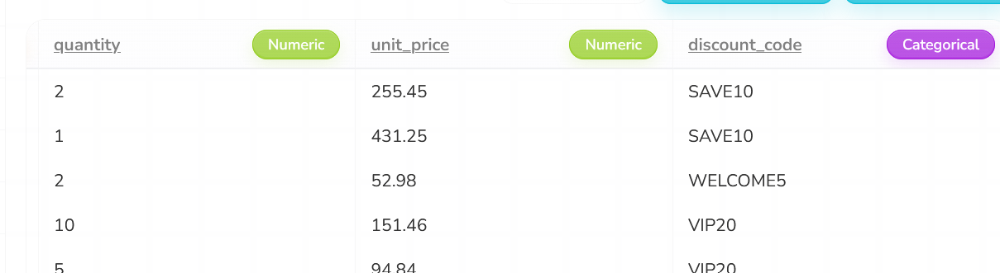

# Schema drift: add a column

**Severity:** High (wrong data reaches GCS with no warning)

## Summary
A new column (`discount_code`) was added to the input. Rhombus carried on as normal and reported "Success", but 5 duplicate orders slipped through to GCS because the new column made them look different.

## Test input
| Item | Value |
|---|---|
| File | `datasets/orders_schema_add_column.csv` |
| Change | New column `discount_code` with random codes (SAVE10, WELCOME5, VIP20, ...) |
| md5 / S3 ETag | `9e8ca0cb9ea03dc5acd4aec870ab8193` |

## Expected (written before the run)
The pipeline carries on. Because `discount_code` is random, 5 of the 10 duplicate pairs are no longer exact copies, so the duplicate step keeps them. Result: 181 rows instead of 176, 10 columns instead of 9, and 5 repeated order_ids.

## What happened
1. **11 Oct, 17:13:** uploaded the file to S3. The schedule skipped the 17:15, 17:30 and 17:45 runs with "Skipped due to unchanged data", even though the file had changed. Clicking "Refresh access" did not help. (See `schedule-behaviour.md`.)
2. **12 Oct, 13:41:03:** uploaded the file again and started a manual run. It finished in 11 seconds (13:41:31 to 13:41:42) with "Success".
3. The Data Input preview now showed `discount_code` as a new "Categorical" column.
4. **13:45:06:** the scheduled run (#17965) also ran and succeeded (7.6 s).

## Answers to the test questions
| Question | Answer |
|---|---|
| Does it stop, warn or carry on? | Carries on. No warning about the new column. |
| What reaches GCS? | 181 rows and 10 columns. 5 orders appear twice. |
| Are the logs clear? | The run shows "Success", so nothing tells the user the output changed. |
| Chatbot | Not used: there was no error to fix. |
| Schedule | First attempt: skipped 3 times as "unchanged data". After a manual run, the next scheduled run worked. |
| Same result every time? | Yes. Manual and scheduled outputs are identical (md5 `6fb3aa148025a9e0466befb6b1695ab8`). |

## Validation results
`validate.py` (12 of 16 checks passed, failures shown):
```
[FAIL] Columns match expected  (missing=[], extra=['discount_code'])
[FAIL] Row count  (expected 176, got 181)
[FAIL] order_id is unique  (5 repeated order_ids)
[FAIL] email_valid counts  (expected {True: 161, False: 15}, got {True: 166, False: 15})
```

`compare_baseline.py`:
```
Rows: baseline 176, new 181
[FAIL] new has 5 repeated order_ids, comparing the first of each
[FAIL] columns only in baseline: [], only in new: ['discount_code']
[PASS] customer_name: all 176 rows match
[PASS] email: all 176 rows match
[PASS] state: all 176 rows match
[PASS] order_date: all 176 rows match
[PASS] quantity: all 176 rows match
[PASS] unit_price: all 176 rows match
[PASS] email_valid: all 176 rows match
[PASS] line_total: all 176 rows match
```

## Why it happened
The duplicate step removes rows only when **every** column is the same. A new column with different values in each copy makes real duplicates look unique. The other cleaning steps still worked correctly.

## Why it matters
Those 5 orders would be counted twice in any sales total built from this data. Nothing in Rhombus shows that anything went wrong.

## Suggestions
- Warn when the input has columns the pipeline has not seen before.
- Remove duplicates by a key (`order_id`), not by every column.
- Show a short "what changed since last run" summary (rows in, rows out, new columns).

## Evidence
The Data Input preview after the manual run, showing the new `discount_code` column taken in as "Categorical" with no warning:



Executions showing the scheduled run #17965 at 13:45 with "Success":


Other evidence:
- Executions export: [`evidence/executions.csv`](evidence/executions.csv) (run #17965)
- Manual output: [`schema_add_column_1341.csv`](evidence/outputs/schema_add_column_1341.csv) (md5 `6fb3aa148025a9e0466befb6b1695ab8`)
- Scheduled output: [`schema_add_column_1345.csv`](evidence/outputs/schema_add_column_1345.csv) (same md5)