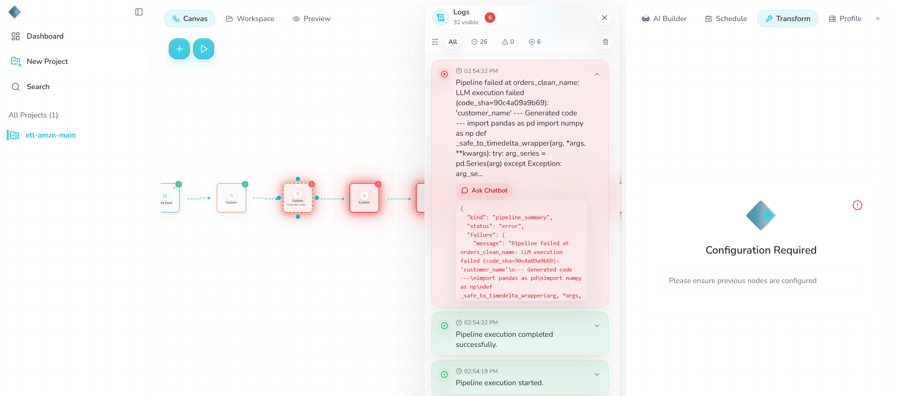

# Schema drift: all changes at once

**Severity:** Medium. The pipeline stops safely, but it reports only the first problem, so the user has to fix and re-run several times to find the rest.

## Summary
The input had all four schema changes together. Rhombus stopped at the first step that touched a changed column (the name step) and reported only that one problem. The missing email, the text in quantity and the extra column were never mentioned.

## Test input
| Item | Value |
|---|---|
| File | `datasets/orders_schema_combined.csv` |
| Changes | `email` removed, `customer_name` renamed to `name`, `quantity` as text ("3 units"), new column `discount_code` |
| md5 (dataset file) | `[paste md5]` |

## Expected (written before the run)
It fails at the name step, because that is the first step that uses a changed column. Only that error is shown.

## What happened
1. **14:54:19:** manual run. It failed at **14:54:32** at the step `orders_clean_name`, with the same error as the rename case:
   *"LLM execution failed (code_sha=90c4a09a9b69): 'customer_name'"*
2. The "completed successfully" line appeared again at the same second.
3. Nothing new reached GCS.

## Which changes did Rhombus report?
| Change | Reported? |
|---|---|
| `customer_name` renamed to `name` | Yes, as the cryptic `'customer_name'` |
| `email` removed | No |
| `quantity` changed to text | No |
| New column `discount_code` | No |

## Answers to the test questions
| Question | Answer |
|---|---|
| Does it stop, warn or carry on? | Stops at the name step. |
| What reaches GCS? | Nothing new. |
| Are the logs clear? | **No.** One cryptic message, and nothing about the other three changes. |
| Chatbot | Not tested (same pattern already shown in the drop and rename cases). |
| Schedule | No scheduled run fell during this case. |

## Why it happened
Each step only checks what it needs, at the moment it runs. There is no check at the start that compares the incoming columns with what the pipeline expects. So the first broken step stops everything, and later problems stay hidden.

## Why it matters
A user would fix the rename, re-run, hit the email error, fix it, re-run, hit the quantity error, and so on: up to four rounds to find four problems that were all visible in the file from the start.

## Suggestions
- Add a schema check at the start of every run: compare column names and types with the last good run, and list **every** difference in one message.
- Let users choose what to do with each kind of change (stop, warn, or carry on).

## Evidence
The failure in Logs at 14:54:32, reporting only the rename:

Other evidence:
- Executions export: [`executions.csv`](evidence/executions.csv)