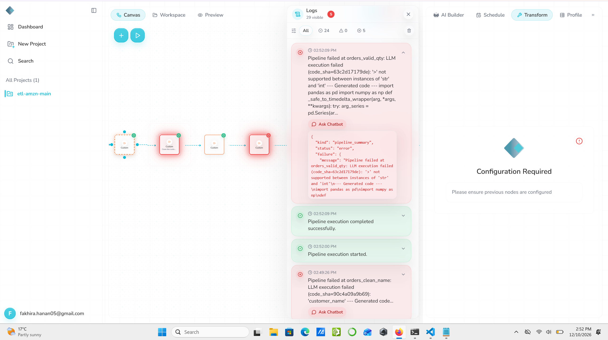

# Schema drift: change a column's type

**Severity:** Medium. The pipeline stops safely, but the error does not say which column or value caused it.

## Summary
`quantity` was changed from numbers to text like "3 units". Rhombus stopped at the quantity step, and nothing reached GCS. But the error was a raw Python message that names neither the column nor the bad value.

## Test input
| Item | Value |
|---|---|
| File | `datasets/orders_schema_type_change.csv` |
| Change | `quantity` written as text, for example `3 units` instead of `3` |
| md5 (dataset file) | `[paste md5]` |

## Expected (written before the run)
Two possible outcomes:
- **Safe:** the quantity step fails, because it compares text like "3 units" with 0.
- **Dangerous:** the step turns "3 units" into empty values and quietly drops those rows, then reports "Success".

## What happened
1. **14:52:00:** manual run. It failed at **14:52:09** at the step `orders_valid_qty`:
   *"LLM execution failed (code_sha=63c2d17179de): '>' not supported between instances of 'str' and 'int'"*
2. The "Pipeline execution completed successfully" line appeared again at the same second.
3. The earlier steps (duplicates, names, states) passed.
4. Nothing new reached GCS. The safe outcome.

## Answers to the test questions
| Question | Answer |
|---|---|
| Does it stop, warn or carry on? | Stops at the quantity step. No warning at import that `quantity` is now text. |
| What reaches GCS? | Nothing new. |
| Are the logs clear? | **No.** The message is a raw Python error. It does not say the column is `quantity` or show a value like "3 units". The user has to guess. |
| Chatbot | Not tested. Two earlier tests (drop and rename) already showed the same pattern. |
| Schedule | No scheduled run fell during this case. |

## Error messages compared
| Case | Step | Error text | Clear? |
|---|---|---|---|
| Drop column | `orders_email_checked` | *"Column 'email' does not exist in target_df!"* | Yes |
| Rename column | `orders_clean_name` | *"'customer_name'"* | No |
| Type change | `orders_valid_qty` | *"'>' not supported between instances of 'str' and 'int'"* | No |

Only 1 of the 3 failing steps explains the problem in plain words.

## Why it happened
The quantity step checks `quantity > 0`. When the column holds text, Python cannot compare text with a number and stops. The step does not check the column's type first, so Python's own message is all the user sees.

## Why it matters
Stopping is the right outcome here, much better than quietly dropping rows. But the message turns a simple problem ("quantity now has words in it") into a debugging task.

## Suggestions
- Warn at import when a column's type changes from the last run (here: number to text).
- In error messages, name the column and show a few example bad values.
- Optionally offer to clean values like "3 units" into 3, with a warning, instead of failing.

## Evidence
The failure in Logs at 14:52:09, with "completed successfully" at the same second:

Other evidence:
- Executions export: [`executions.csv`](evidence/executions.csv)