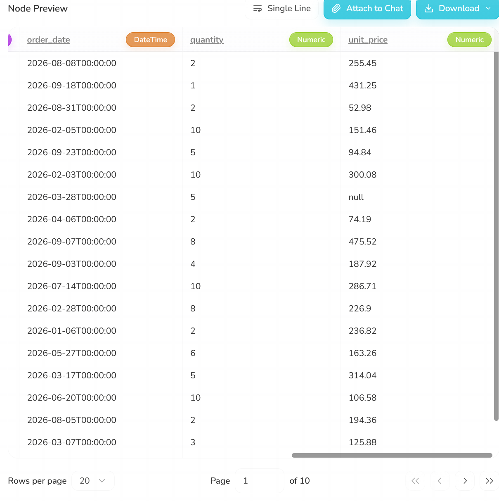

# Semantic drift: dates written day-first

**Severity:** High (36% of dates silently changed, and they still look like real dates)

## Summary
The order dates were written day-first (DD/MM/YYYY), as is common in Australia. Rhombus reported "Success" with no warning, but it swapped the day and month whenever the day was 12 or less. 64 of 176 orders (36%) reached GCS with the wrong date. My format check missed it too; only the baseline comparison caught it.

## Test input
| Item | Value |
|---|---|
| File | `datasets/orders_semantic_date_day_first.csv` |
| Change | `order_date` written as DD/MM/YYYY (for example `02/05/2026` for 2 May). Everything else is the same as the baseline. |
| md5 / S3 ETag | `9419bc58e1b83657d37f07eee4b5dd4d` |
| Uploaded | 12 Oct, 13:05:36 |

## Expected (written before the run)
Rhombus gives no warning. Some dates may be read the wrong way round. `validate.py` may still pass, because it only checks that dates look like YYYY-MM-DD, not that they are the right dates.

## What happened
1. **13:05:36:** uploaded the file, then started a manual run straight away (no re-select needed). The output was written to GCS at 13:06:29 with "Success".
2. The Data Input preview already showed swapped dates, before any cleaning step ran:

| order_id | Correct date | Date in Rhombus |
|---|---|---|
| 1159 | 2026-05-02 | **2026-02-05** |
| 1116 | 2026-03-02 | **2026-02-03** |
| 1171 | 2026-06-04 | **2026-04-06** |
| 1175 | 2026-07-09 | **2026-09-07** |
| 1046 | 2026-03-09 | **2026-09-03** |
| 1016 | 2026-09-18 | 2026-09-18 (correct) |

3. Dates with a day above 12 (like 18/09) were read correctly, because they can only mean one thing. Dates with a day of 12 or less were read month-first.
4. The scheduled runs at 13:15 and 13:30 were skipped (see `schedule-behaviour.md`).

## Answers to the test questions
| Question | Answer |
|---|---|
| Does it stop, warn or carry on? | Carries on. No warning. |
| Does Rhombus notice? | No. The run says "Success". |
| Does my validation catch it? | `validate.py`: **no** (16 of 16 passed, all dates look valid). `compare_baseline.py`: **yes** (64 dates differ). |
| What reaches GCS? | 176 rows, right columns, 64 wrong dates. |
| Are the logs clear? | They show "Success". Nothing about dates. |
| Chatbot | Not used: there was no error to fix. |
| Schedule | 13:15 and 13:30 were skipped; no scheduled run during this case. |
| Same result every time? | Not tested: only one run of this file. |

## Validation results
`validate.py`:
```
16 passed, 0 failed
```

`compare_baseline.py`:
```
Rows: baseline 176, new 176
[PASS] customer_name: all 176 rows match
[PASS] email: all 176 rows match
[PASS] state: all 176 rows match
[FAIL] order_date: 64 of 176 rows differ
       order_id 1159: baseline '2026-05-02', new '2026-02-05'
       order_id 1116: baseline '2026-03-02', new '2026-02-03'
       order_id 1171: baseline '2026-06-04', new '2026-04-06'
       order_id 1175: baseline '2026-07-09', new '2026-09-07'
       order_id 1046: baseline '2026-03-09', new '2026-09-03'
[PASS] quantity: all 176 rows match
[PASS] unit_price: all 176 rows match
[PASS] email_valid: all 176 rows match
[PASS] line_total: all 176 rows match
```

## Why it happened
Data Input guesses the date format for each value on its own. When the day is 12 or less, it reads the date month-first (US style). When the day is above 12, month-first is impossible, so it reads it correctly. The result is one column with two different readings, and no warning.

There is also a contradiction: Rhombus's own screens show dates day-first (Executions shows 11 October as `11/10/2026`), but it read `02/05/2026` in the file as 5 February.

## Why it matters
More than a third of orders move to the wrong month. Monthly sales reports would be wrong, and because every date is still a real, valid date, nobody would spot it. Format checks alone cannot catch this; you need to compare against known values.

## Suggestions
- Let users choose the date format in Data Input (DD/MM or MM/DD).
- Warn when a date column is ambiguous (days of 12 or less) or when values in one column were read in different ways.
- Never mix two readings in the same column; if unsure, stop and ask.

## Evidence
Before (price-in-cents run, dates correct) and after (day-first run, dates swapped). Same rows, same order:




Other evidence:
- Output: [`date_day_first.csv`](evidence/outputs/date_day_first.csv)