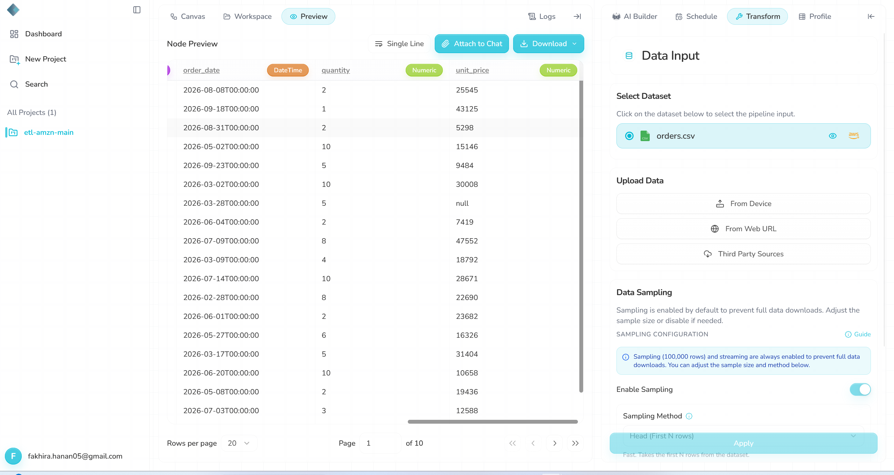

# Semantic drift: prices in cents

**Severity:** High (wrong numbers reach GCS and look valid)

## Summary
Prices were sent in cents instead of dollars (25545 instead of 255.45). Rhombus processed the file and reported "Success" with no warning. Every price and line total in GCS is 100 times too big. My validation caught it; Rhombus did not.

## Test input
| Item | Value |
|---|---|
| File | `datasets/orders_semantic_price_cents.csv` |
| Change | `unit_price` multiplied by 100 (cents). Everything else is the same as the baseline. |
| md5 / S3 ETag | `c1edb110eb5e01552415cff2f1cb6334` |
| Uploaded | 12 Oct, 08:12:48 |

## Expected (written before the run)
Rhombus gives no warning and passes the prices through. `validate.py` should fail only the price range check (5 to 500).

## What happened
1. **08:12:48:** uploaded the file. The **08:15** scheduled run was skipped as "unchanged data". The Data Input preview still showed the old dollar prices (order 1096: `25545` in S3, `255.45` in Rhombus).
2. **About 08:26:** re-selected the file in Third Party Sources. The dataset preview now showed `25545`, but the **08:30** run was still skipped.
3. **08:35:40:** started a manual run. It finished at 08:35:49 with "Success".
4. **08:45:12:** the scheduled run #17936 ran by itself and also succeeded (7.6 s), writing the same data a second time.

## Answers to the test questions
| Question | Answer |
|---|---|
| Does it stop, warn or carry on? | Carries on. No warning. |
| Does Rhombus notice? | No. Both runs say "Success". |
| Does my validation catch it? | Yes. The price range check fails, and the baseline comparison shows every `unit_price` and `line_total` changed. |
| What reaches GCS? | 176 rows with the right columns, but prices and line totals 100 times too big. |
| Are the logs clear? | They show "Success" and how many rows each step changed. Nothing about the price values. |
| Chatbot | Not used: there was no error to fix. |
| Schedule | Skipped at 08:00, 08:15 and 08:30 as "unchanged data". Ran at 08:45, after the manual run. |
| Same result every time? | Yes. Manual and scheduled outputs are identical (md5 `3ee9caa87fdb02f795e47438121e6521`). |

## Validation results
`validate.py` (15 of 16 checks passed, failure shown):
```
[FAIL] unit_price between 5 and 500  (min=607.0, max=49969.0)
```

`compare_baseline.py`:
```
Rows: baseline 176, new 176
[PASS] customer_name: all 176 rows match
[PASS] email: all 176 rows match
[PASS] state: all 176 rows match
[PASS] order_date: all 176 rows match
[PASS] quantity: all 176 rows match
[FAIL] unit_price: 176 of 176 rows differ
       order_id 1096: baseline '255.45', new '25545.0'
       order_id 1016: baseline '431.25', new '43125.0'
       order_id 1031: baseline '52.98', new '5298.0'
       order_id 1159: baseline '151.46', new '15146.0'
       order_id 1129: baseline '94.84', new '9484.0'
[PASS] email_valid: all 176 rows match
[FAIL] line_total: 176 of 176 rows differ
       order_id 1096: baseline '510.9', new '51090.0'
       order_id 1016: baseline '431.25', new '43125.0'
       order_id 1031: baseline '105.96', new '10596.0'
       order_id 1159: baseline '1514.6', new '151460.0'
       order_id 1129: baseline '474.2', new '47420.0'
```

## Why it happened
The pipeline checks that a price exists (no missing values), but not whether it makes sense. Nothing compares new values with earlier runs, so a 100 times jump looks normal.

## Why it matters
Revenue and order totals would be 100 times too high in any report built on this data. The file looks clean (right columns, no blanks, numbers in the price column), so nobody would notice until the numbers were used.

## Suggestions
- Let users set an allowed range for a column (for example price 5 to 500) and warn when values fall outside it.
- Compare simple numbers with the last run (for example the average price) and flag big jumps.
- Show a short summary of key numbers after each run.

## Evidence
The skip message at 08:18, even though the S3 file had changed:


The Data Input node after the manual run, now showing prices in cents:



Other evidence:
- What Rhombus held before the re-select (still dollar prices): [`data-input-after-price-cents.csv`](evidence/data-input-after-price-cents.csv)
- Manual output: [`price_cents_0835.csv`](evidence/outputs/price_cents_0835.csv) (md5 `3ee9caa87fdb02f795e47438121e6521`)
- Scheduled output: [`price_cents_0845.csv`](evidence/outputs/price_cents_0845.csv) (same md5)
- Executions export: [`executions.csv`](evidence/executions.csv) (run #17936)