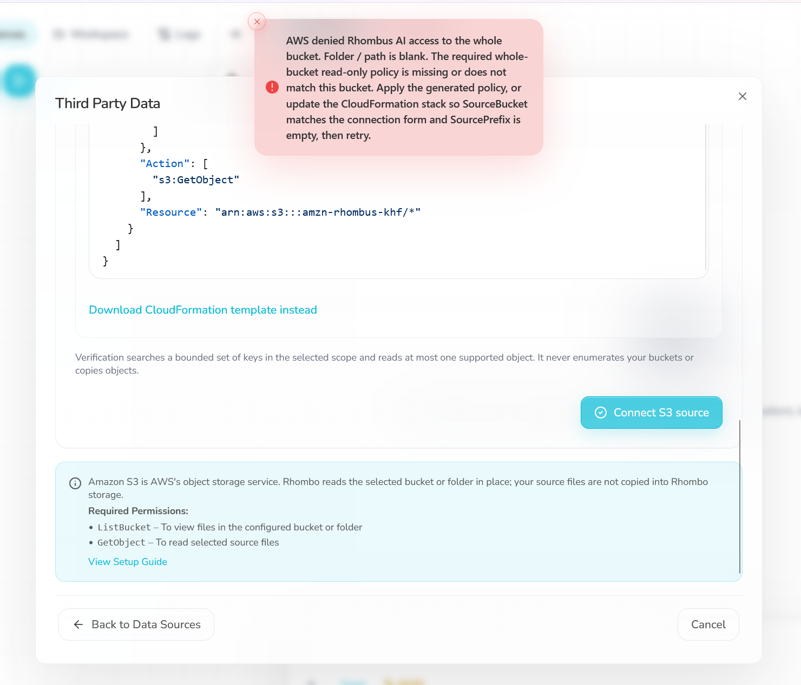
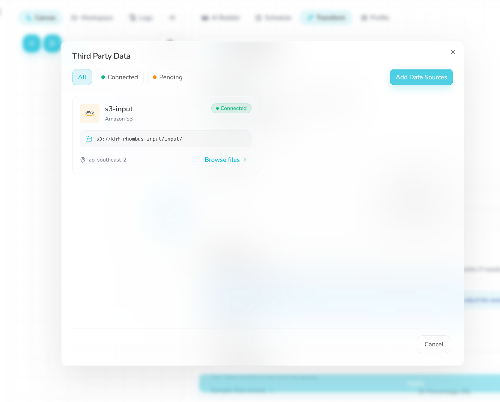

# Setup: connecting S3 to Rhombus

**Severity:** High (blocks setup at the first step)

## Summary
Connecting my S3 bucket to Rhombus failed 5 times on my first AWS account. The cause was an AWS policy that Rhombus does not mention anywhere. The same steps worked first time on a standard AWS account.

## What I did
1. Created an AWS account using "Sign up for AWS (new)", logging in with GitHub.
2. Created a bucket and followed the Rhombus S3 steps, including the bucket policy Rhombus generates.
3. Rhombus showed this error: *"AWS denied Rhombus AI access to the whole bucket. Folder / path is blank. The required whole-bucket read-only policy is missing or does not match this bucket. Apply the generated policy, or update the CloudFormation stack so SourceBucket matches the connection form and SourcePrefix is empty, then retry."* The policy was already applied and the bucket name matched, so the message pointed me in the wrong direction.
4. Checked the policy, tried again, and asked the chatbot twice (10 credits). 5 attempts in total, all failed.
5. Created a standard AWS account (without using GitHub account), made the bucket `khf-rhombus-input` in Sydney (ap-southeast-2) and applied the same Rhombus policy. It connected first time.

## Root cause
AWS accounts created with "Sign up for AWS (new)" come with an AWS-managed resource control policy called `DenyAnyoneOutsideMyOrgAndAWS`. It blocks access from outside the account's organisation, which includes Rhombus's roles. It cannot be changed, so no bucket policy can fix it.

## What Rhombus did
- **Error message:** blamed a missing or mismatched bucket policy, which sent me in the wrong direction.
- **Docs and troubleshooting page:** no mention of this type of account.
- **Chatbot (2 prompts):** did not find the cause. Both the chatbot and the error message say "retry", but there is no Retry button; the button is called "Connect S3 source".
- **Help text:** says "this prefix only" even when the folder field is blank.

## Impact
Any new user who signs up for AWS the new way (GitHub or Google login) will hit this and get a misleading error, at the very first step of using Rhombus.

## Suggestions
- Detect this case and say it in the error, for example: "Your AWS account has an organisation policy that blocks outside access."
- Add it to the docs and the troubleshooting page.
- Fix the help text and the button name used in the error and by the chatbot.

## Final setup
| Item | Value |
|---|---|
| AWS account | Standard account |
| Bucket | `khf-rhombus-input`, ap-southeast-2 (Sydney) |
| Settings | Versioning on, Block Public Access on, SSE-S3 encryption |
| Access | Bucket policy generated by Rhombus, limited to `input/` |
| Old account buckets | `amzn-rhombus-khf`, `khf-rhombus-test` (kept as evidence, deleted at the end) |

## Evidence
The error on the old account (note the old bucket `amzn-rhombus-khf` in the policy):

The working connection on the standard account:

